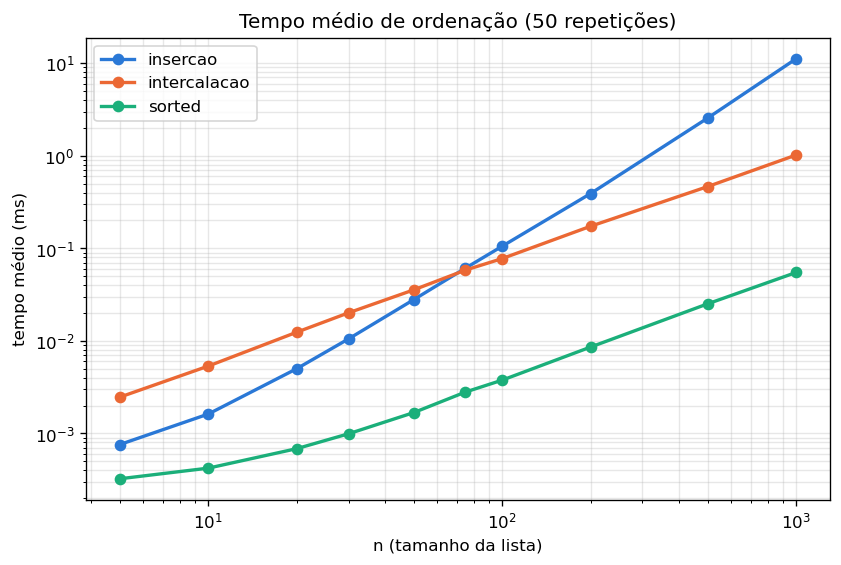
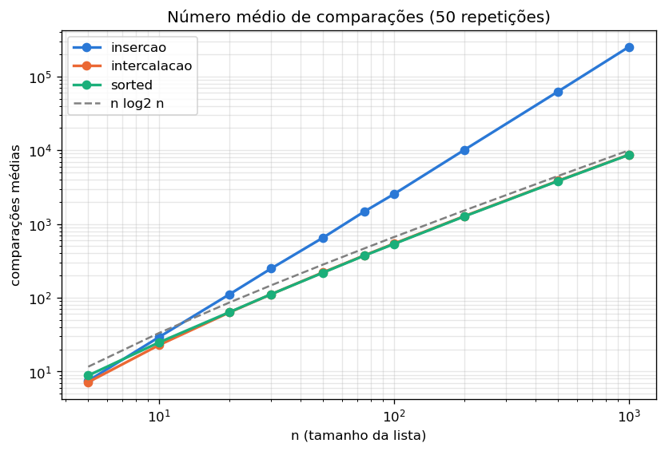

# Relatório: Inserção x Intercalação

Medições feitas com Python 3.14 no Linux, rodando `python medir.py`. Cada valor é a média de 50 listas aleatórias (o mínimo pedido era 10). Os números brutos estão em `dados.csv`.

## Tabela de tempos

Tempo médio em milissegundos.

| n | inserção (ms) | intercalação (ms) | sorted() (ms) | mais rápido entre os dois |
|---:|---:|---:|---:|---|
| 5 | 0.0008 | 0.0025 | 0.0003 | inserção |
| 10 | 0.0016 | 0.0053 | 0.0004 | inserção |
| 20 | 0.0050 | 0.0124 | 0.0007 | inserção |
| 30 | 0.0105 | 0.0201 | 0.0010 | inserção |
| 50 | 0.0279 | 0.0356 | 0.0017 | inserção |
| 75 | 0.0610 | 0.0581 | 0.0028 | intercalação |
| 100 | 0.1053 | 0.0774 | 0.0038 | intercalação |
| 200 | 0.3905 | 0.1731 | 0.0086 | intercalação |
| 500 | 2.5477 | 0.4638 | 0.0251 | intercalação |
| 1000 | 11.1385 | 1.0174 | 0.0548 | intercalação |

## Tabela de comparações

Número médio de comparações. As duas últimas colunas são as referências teóricas usadas no extra.

| n | inserção | intercalação | sorted() | n log2 n | log2(n!) |
|---:|---:|---:|---:|---:|---:|
| 5 | 7.5 | 7.2 | 8.8 | 11.6 | 6.9 |
| 10 | 29.2 | 22.8 | 24.8 | 33.2 | 21.8 |
| 20 | 111.8 | 63.4 | 64.0 | 86.4 | 61.1 |
| 30 | 248.7 | 111.4 | 111.4 | 147.2 | 107.7 |
| 50 | 654.3 | 221.2 | 219.1 | 282.2 | 214.2 |
| 75 | 1480.7 | 376.1 | 373.1 | 467.2 | 363.4 |
| 100 | 2541.1 | 541.3 | 535.3 | 664.4 | 524.8 |
| 200 | 10169.2 | 1283.2 | 1271.5 | 1528.8 | 1245.4 |
| 500 | 62694.1 | 3855.3 | 3825.9 | 4482.9 | 3767.4 |
| 1000 | 251904.6 | 8707.7 | 8660.1 | 9965.8 | 8529.4 |

## Gráficos

Os dois gráficos usam escala logarítmica nos dois eixos. Sem isso, as curvas dos valores pequenos de n ficariam espremidas no zero e não daria para ver onde elas se cruzam.

## Em que n a intercalação passa a ser mais rápida

**Entre n = 50 e n = 75.** Até n = 50 a inserção é mais rápida. Em n = 75 a intercalação já ganha (0.0581 ms contra 0.0610 ms) e a diferença só aumenta daí em diante: em n = 1000 a intercalação é cerca de 11 vezes mais rápida.

Rodamos o `medir.py` várias vezes e a virada sempre caiu nesse mesmo intervalo. Em outra máquina ou outra versão do Python o ponto pode mudar um pouco, porque depende do custo de cada operação no interpretador.

## Os dois gráficos dão o mesmo ponto de virada?

**Não.** Pelas comparações, a intercalação ganha praticamente desde o começo: em n = 5 já faz um pouco menos comparações (7.2 contra 7.5) e em n = 10 a diferença é clara (22.8 contra 29.2). Pelo tempo, a virada só acontece entre 50 e 75.

O motivo é que contar comparações não mede todo o trabalho do algoritmo. A comparação é só uma das operações:

- **Inserção:** o laço interno é simples. Compara, desloca um elemento uma posição para a direita e segue. Tudo acontece dentro da própria lista, sem criar lista nova e sem chamar função.
- **Intercalação:** além das comparações, faz uma chamada recursiva para cada pedaço da lista, cria listas novas a cada fatiamento (`lista[:meio]`, `lista[meio:]`), monta o resultado com `append` e copia as sobras com `extend`. Em Python, chamar função e criar lista custa bem mais do que uma comparação.

Para n pequeno esse custo fixo da intercalação pesa mais do que as poucas comparações que ela economiza. Conforme n cresce, a inserção passa a fazer muito mais comparações (cerca de n²/4, contra cerca de n log2 n), essa diferença cresce mais rápido do que o custo extra da intercalação, e a intercalação passa à frente.

## Por que comparar com sorted() não serve para decidir entre os dois

O `sorted()` foi o mais rápido em todos os tamanhos (cerca de 18 vezes mais rápido que a intercalação em n = 1000), mas isso não diz nada sobre inserção x intercalação:

1. **É outro algoritmo.** O `sorted()` usa o Timsort, um híbrido que procura trechos já ordenados na lista, ordena pedaços pequenos com inserção binária e depois junta os pedaços com intercalação. Ele não é nenhum dos dois que estamos comparando.
2. **É escrito em C.** As nossas versões rodam no interpretador Python, onde cada linha custa muito mais. Boa parte da vantagem do `sorted()` vem disso, e não do algoritmo. A tabela de comparações mostra isso: o `sorted()` faz praticamente o mesmo número de comparações que a nossa intercalação, mas é cerca de 18 vezes mais rápido.
3. **Ele fica abaixo dos dois em todos os n.** Se ele é o mais rápido sempre, não existe ponto em que ele ajude a escolher entre inserção e intercalação. Para decidir entre os dois, eles precisam ser comparados entre si, escritos na mesma linguagem e do mesmo jeito.

O `sorted()` serve como referência do que uma implementação otimizada consegue, não como critério de escolha.

## Um caso em que a inserção ainda é a escolha certa

**Listas quase ordenadas.** Quando a lista já está ordenada ou quase, a inserção quase não desloca nada: cada elemento é comparado com o anterior e já fica no lugar. O custo cai para perto de n. A intercalação não aproveita isso e faz todas as divisões e cópias do mesmo jeito.

Testamos com uma lista já ordenada de 1000 elementos:

| | comparações | tempo (ms) |
|---|---:|---:|
| inserção | 999 | 0.054 |
| intercalação | 4932 | 0.687 |

As 999 comparações são n − 1, o mesmo comportamento mostrado em aula para n = 2000 (1.999 comparações com a lista já ordenada). A inserção foi cerca de 12 vezes mais rápida. Um exemplo prático é uma lista que já está ordenada e recebe poucos itens novos de vez em quando: inserir os novos no lugar é mais barato do que reordenar tudo.

Pelas medições, ela também é a melhor escolha para listas pequenas (até uns 50 elementos aqui). Por isso o próprio Timsort usa inserção nos pedaços pequenos. Outra vantagem é que a inserção ordena sem precisar de memória extra, enquanto a intercalação precisa de listas auxiliares do tamanho da entrada.

## Extra: comparações do sorted()

Para contar as comparações do `sorted()`, cada número foi colocado dentro de uma classe `Contador` que guarda o valor e soma 1 a cada chamada de `__lt__`. Como o `sorted()` só usa `<` para comparar, o contador mostra exatamente quantas comparações ele fez. A mesma classe foi usada para contar as comparações da inserção e da intercalação.

Comparando com o limite de n log n visto em aula (tabela de comparações acima):

- O argumento da aula: com k comparações dá para distinguir no máximo 2^k casos, e é preciso distinguir as n! ordens possíveis. Então 2^k ≥ n!, ou seja, k ≥ log2(n!). O "n log n" é a forma simplificada desse valor, já que log2(n!) é aproximadamente n log2 n − 1,44n. Por isso a tabela traz as duas colunas: log2(n!) é o piso exato e n log2 n é a curva tracejada do gráfico.
- O `sorted()` nunca ficou abaixo de log2(n!), como a aula garante. Em n = 1000 foram 8660 comparações, contra um piso de 8529, só cerca de 1,5% acima.
- Ele ficou abaixo da curva n log2 n (9966 em n = 1000), mas isso não contradiz a aula. A forma simplificada n log2 n deixa de fora o termo −1,44n e por isso fica um pouco acima do piso exato.
- A nossa intercalação ficou praticamente igual ao `sorted()` em número de comparações (8708 em n = 1000), o que faz sentido, porque o Timsort também é baseado em intercalação. Já a inserção fez 251905, cerca de 29 vezes mais, porque cresce com n².
- Nos tamanhos pequenos (até n = 20) o `sorted()` fez um pouco mais comparações que a intercalação. Para listas pequenas o Timsort usa inserção binária mais a detecção de trechos ordenados, então gasta algumas comparações a mais. Mesmo assim o número continua na mesma ordem de grandeza de log2(n!).

Concluindo, o `sorted()` está na ordem de n log n, como esperado, e bem perto do mínimo teórico para algoritmos baseados em comparação.
