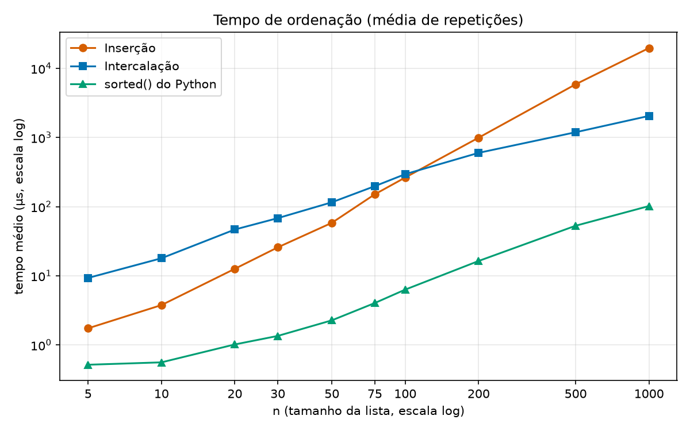

# Relatório: ordenação por inserção × ordenação por intercalação

## Resumo

- **Tempo:** a intercalação passa a ser mais rápida em **n = 200** (primeiro tamanho medido em que ela ganha e nunca mais perde). Em n = 100 a inserção ainda está à frente (263,66 µs contra 294,90 µs). Como não há tamanhos entre 100 e 200, o cruzamento exato não foi medido. Uma interpolação o coloca perto de **n ≈ 115**.
- **Comparações:** a intercalação já faz menos comparações **desde n = 4**, antes do menor tamanho medido. **Os dois gráficos não dão o mesmo ponto de virada**: o de comparações vira em n ≈ 4 e o de tempo em n ≈ 115 a 200 (seção 4).
- **`sorted()`** é de 3,4 a 193 vezes mais rápido que as duas implementações, conforme o tamanho. Isso não diz qual das duas é melhor (seção 5).
- **O tempo depende do ambiente, as comparações não.** Repetindo a medição em outro ambiente, a virada do tempo caiu para n = 75, enquanto as contagens de comparações dos dois algoritmos saíram idênticas (seção 8).

## 1. Como foi medido

- **Algoritmos:** `ordenacao.py`. Os dois devolvem uma lista nova, são estáveis e só comparam com `<`.
- **Listas:** permutações aleatórias de `0..n-1`, com semente fixa (42). Em cada repetição sorteia-se uma lista nova, e as três funções ordenam **a mesma lista**.
- **Repetições:** 30 por tamanho (o mínimo exigido era 10). Todas as médias abaixo são sobre as 30 repetições. Os números brutos estão em `dados.csv` (300 linhas, uma por repetição).
- **Tempo:** `time.perf_counter_ns`, com o coletor de lixo desligado durante a medida. Para listas pequenas uma única chamada dura menos que o ruído do relógio. Por isso cada repetição cronometra `1000 // n` chamadas seguidas sobre a mesma lista (200 chamadas em n = 5, 1 em n = 1000) e divide pelo número de chamadas. As funções não alteram a entrada, então isso é seguro.
- **Comparações:** em uma passada separada (fora do tempo), cada valor é embrulhado numa classe que conta as chamadas de `__lt__`. O código dos algoritmos é exatamente o mesmo que foi cronometrado.
- **Ambiente:** CPython 3.12.12, Linux (WSL) rodando no Windows. Os tempos absolutos mudam de máquina para máquina e de versão para versão do Python (seção 8). A ordem entre os métodos e a forma das curvas é o que importa.

## 2. Resultados

### Tempo médio (µs)

| n | Inserção | Intercalação | sorted() |
|---:|---:|---:|---:|
| 5 | 1,74 | 9,30 | 0,52 |
| 10 | 3,77 | 17,92 | 0,56 |
| 20 | 12,61 | 46,65 | 1,02 |
| 30 | 25,75 | 68,14 | 1,35 |
| 50 | 58,29 | 115,53 | 2,27 |
| 75 | 150,70 | 197,64 | 4,03 |
| 100 | 263,66 | 294,90 | 6,31 |
| 200 | 993,14 | 599,42 | 16,36 |
| 500 | 5877,08 | 1191,01 | 52,91 |
| 1000 | 19678,37 | 2051,71 | 101,95 |

### Comparações médias

| n | Inserção | Intercalação | sorted() |
|---:|---:|---:|---:|
| 5 | 7,5 | 7,2 | 7,6 |
| 10 | 31,0 | 23,2 | 22,9 |
| 20 | 108,8 | 63,9 | 62,9 |
| 30 | 250,6 | 111,9 | 109,8 |
| 50 | 637,5 | 221,6 | 217,5 |
| 75 | 1479,1 | 374,7 | 370,5 |
| 100 | 2527,4 | 543,2 | 535,6 |
| 200 | 10134,2 | 1281,9 | 1266,7 |
| 500 | 62749,0 | 3851,4 | 3816,7 |
| 1000 | 251227,9 | 8712,6 | 8634,5 |

Os dois gráficos usam escala logarítmica nos dois eixos, para que n = 5 e n = 1000 caibam juntos. Nesta escala, uma reta mais inclinada significa crescimento mais rápido. A inserção sobe mais íngreme (quadrática) que a intercalação (n log n). No gráfico de tempo as curvas da inserção e da intercalação se cruzam entre n = 100 e n = 200. No de comparações, a curva do `sorted()` fica quase em cima da curva da intercalação.

Os valores da inserção seguem o esperado para o caso médio: `n(n−1)/4 + n − H_n`, que dá 250 742 para n = 1000 (medido: 251 228).

## 3. Em que n a intercalação passa a ser mais rápida?

| n | Inserção (µs) | Intercalação (µs) | Repetições (de 30) em que a intercalação foi mais rápida |
|---:|---:|---:|---:|
| 50 | 58,29 | 115,53 | 0 |
| 75 | 150,70 | 197,64 | 2 |
| 100 | 263,66 | 294,90 | 5 |
| 200 | 993,14 | 599,42 | 29 |
| 500 | 5877,08 | 1191,01 | 30 |

- Até n = 50, a inserção ganhou em todas as 30 repetições.
- Em **n = 100** a inserção ainda está à frente na média (263,66 µs contra 294,90 µs, cerca de 11% a menos). Os desvios-padrão (35,1 µs e 39,7 µs) são do tamanho da diferença entre as médias (31,2 µs), então olhei também as repetições: a intercalação venceu em 5 das 30.
- Em **n = 200 a intercalação já ganha** na média (599,42 µs contra 993,14 µs) e em 29 das 30 repetições. A média da intercalação está inflada por uma repetição atípica de 1485,76 µs. A mediana é 543,70 µs (a da inserção é 975,51 µs), o que reforça a conclusão. A partir de n = 500 ganha sempre.

**Resposta: n = 200** é o primeiro tamanho medido em que a intercalação é mais rápida. O ponto exato de cruzamento não foi medido, porque não há tamanhos entre 100 e 200. Interpolando a razão entre os tempos (0,894 em n = 100 e 1,657 em n = 200), o cruzamento fica perto de **n ≈ 115**. Isso é uma estimativa, não uma medição. Em outro ambiente a virada ocorreu em n = 75 (seção 8).

## 4. O gráfico de comparações e o de tempo dão o mesmo ponto de virada?

**Não.**

- **Comparações:** a intercalação já usa menos comparações em todos os tamanhos medidos. Em n = 5 a diferença é pequena (7,2 contra 7,5), mas a teoria confirma: calculei a média exata sobre **todas** as permutações para n ≤ 8, e os dois métodos empatam em n = 2 e n = 3 (1,000 e 2,667) e a intercalação usa menos a partir de **n = 4** (4,667 contra 4,917). A virada em comparações fica em n ≈ 4. (Essa verificação está em `testes.py`, classe `TestMediaExata`.)
- **Tempo:** a virada fica em n ≈ 115 a 200, mais de vinte vezes maior.

**Por quê?** O tempo não é só a contagem de comparações. É o número de comparações vezes o custo, por comparação, de tudo o que o algoritmo faz junto com ela. Essa segunda parte é bem diferente nos dois métodos:

| n | Comparações: inserção ÷ intercalação | Tempo por comparação: intercalação ÷ inserção | Mais rápida |
|---:|---:|---:|:---|
| 5 | 1,05 | 5,60 | inserção |
| 10 | 1,34 | 6,36 | inserção |
| 20 | 1,70 | 6,30 | inserção |
| 30 | 2,24 | 5,92 | inserção |
| 50 | 2,88 | 5,70 | inserção |
| 75 | 3,95 | 5,18 | inserção |
| 100 | 4,65 | 5,20 | inserção (por pouco) |
| 200 | 7,91 | 4,77 | **intercalação** |

(Tempo por comparação = tempo médio ÷ comparações médias, em µs: por exemplo, em n = 100 são 0,104 µs na inserção e 0,543 µs na intercalação.)

Cada comparação da intercalação custa de **5 a 6 vezes** mais que a da inserção (o fator cai para 3,0 em n = 1000). A intercalação só compensa quando economiza mais comparações do que esse fator. Em n = 100 a economia é de 4,65× e o custo extra é de 5,20×, então a inserção ainda ganha. Em n = 200 a economia é de 7,91× e o custo extra de 4,77×, então a intercalação passa à frente. O cruzamento fica entre os dois, perto de n ≈ 115, que é o mesmo resultado da interpolação da seção 3.

A explicação mais plausível para o custo maior por comparação: no laço interno da inserção cada comparação vem acompanhada de apenas um deslocamento de elemento. A intercalação, na minha implementação, também faz chamadas recursivas, cria sublistas por fatiamento, usa `append`/`extend` e consulta `len()`, e nada disso entra na contagem de comparações. Não medi essas partes separadamente, então isso é interpretação, não resultado medido.

Consequências:

- A contagem de comparações mede o algoritmo, e é a mesma em qualquer linguagem, máquina ou versão do Python.
- O tempo mede o algoritmo **mais** a implementação e a máquina. Em outra linguagem, com uma intercalação que usa vetor auxiliar em vez de fatias, ou em outra versão do Python, o ponto de virada do tempo muda. A seção 8 mostra isso com dados.

## 5. Por que a comparação com `sorted()` não serve para decidir entre os dois

1. **`sorted()` é um terceiro algoritmo, em outra implementação.** É o Timsort, escrito em C, um híbrido que combina inserção (binária, para trechos curtos) com intercalação. Segundo a documentação do CPython, listas com menos de 64 elementos são ordenadas inteiramente por inserção binária. Ele ainda tem um caminho rápido para comparar inteiros. Comparar os dois algoritmos com ele é comparar Python interpretado com C compilado, e os algoritmos viram detalhe.
2. **A razão não é constante.** O `sorted()` é de 18,0× (n = 5) a 51,0× (n = 50) mais rápido que a intercalação, e 20,1× em n = 1000. Contra a inserção, vai de 3,4× (n = 5) a 193× (n = 1000). Essas razões misturam diferença de algoritmo, de linguagem e de tamanho, e não se separam umas das outras.
3. **Ele ganha das duas por larga margem, então não desempata.** Ser muito mais rápido que ambas é compatível com qualquer uma das duas ser a melhor. A pergunta "qual das duas é melhor?" exige colocá-las nas mesmas condições (mesma linguagem, mesmas listas, mesma medição), que é o que as seções 3 e 4 fazem.
4. **Nas comparações, o `sorted()` fica praticamente igual à intercalação**: a partir de n = 10 usa de 0,9% a 1,9% menos. A vantagem de velocidade dele vem do custo de cada operação, não de comparar muito menos.

O que `sorted()` mostra é uma lição de engenharia: na prática, usa-se a ordenação pronta da linguagem.

## 6. Um caso em que a inserção ainda seria a escolha adequada

**Listas pequenas ou quase ordenadas.**

- **Pequenas:** com o que foi medido aqui, a inserção foi mais rápida em todas as repetições até n = 50, e ainda ganhou na média em n = 75 e n = 100. Em n = 5 ela leva 1,74 µs contra 9,30 µs da intercalação, 5,3 vezes mais rápida. O mesmo raciocínio explica por que o Timsort usa inserção para trechos curtos.
- **Quase ordenadas** (por exemplo, um registro novo entrando numa lista que já está ordenada): o número de comparações da inserção é aproximadamente `n + inversões`. Numa lista já ordenada são `n − 1` comparações, o que `testes.py` verifica, contra cerca de `(n/2)·log2 n` na intercalação, que faz o mesmo trabalho sempre. Não medi o tempo desse caso aqui, é conclusão a partir do algoritmo e dos testes.

Além disso, a inserção ordena no próprio lugar, sem memória auxiliar, é estável e é simples de implementar e de depurar. Em ambientes com pouca memória, ou como caso-base de um algoritmo híbrido, continua sendo uma boa escolha.

## 7. Extra: comparações do `sorted()`

Contadas com a classe `ElementoContado` (que conta as chamadas de `__lt__`), como sugerido. O mínimo teórico `log2(n!)` é o número de comparações que qualquer ordenação por comparação precisa, em média, sobre permutações aleatórias. É a forma exata do limite n log n visto em aula, já que `log2(n!) ≈ n·log2 n − 1,44·n`. Os valores abaixo são do Python 3.12.12 (na seção 8, a diferença para a versão 3.13).

| n | sorted() | n·log2(n) | log2(n!) | sorted() ÷ (n·log2 n) | sorted() ÷ log2(n!) |
|---:|---:|---:|---:|---:|---:|
| 5 | 7,6 | 11,6 | 6,9 | 0,65 | 1,10 |
| 10 | 22,9 | 33,2 | 21,8 | 0,69 | 1,05 |
| 20 | 62,9 | 86,4 | 61,1 | 0,73 | 1,03 |
| 30 | 109,8 | 147,2 | 107,7 | 0,75 | 1,02 |
| 50 | 217,5 | 282,2 | 214,2 | 0,77 | 1,02 |
| 75 | 370,5 | 467,2 | 363,4 | 0,79 | 1,02 |
| 100 | 535,6 | 664,4 | 524,8 | 0,81 | 1,02 |
| 200 | 1266,7 | 1528,8 | 1245,4 | 0,83 | 1,02 |
| 500 | 3816,7 | 4482,9 | 3767,4 | 0,85 | 1,01 |
| 1000 | 8634,5 | 9965,8 | 8529,4 | 0,87 | 1,01 |

- **Consistente com n log n.** O `sorted()` fica entre 65% e 87% de `n·log2 n`. Fica abaixo porque `n log n` descreve a ordem de crescimento e ignora o termo `−1,44·n`. A razão sobe devagar em direção a 1 conforme n cresce, porque esse termo pesa cada vez menos.
- **Quase no mínimo possível.** A partir de n = 20 ele usa no máximo 3% acima de `log2(n!)`, e 1% acima em n = 1000. Não há margem para um algoritmo de comparação muito melhor.
- **Para listas muito pequenas ele gasta um pouco mais** (1,10× o mínimo em n = 5, 1,05× em n = 10).
- **Muito próximo da intercalação.** Em n = 5 o `sorted()` usa 6,0% mais comparações que a nossa intercalação (7,6 contra 7,2). A partir de n = 10 usa de 0,9% a 1,9% menos.

## 8. Outro ambiente: o que muda e o que não muda

Rodei a mesma medição em um segundo ambiente (contêiner Linux na nuvem, 2 vCPUs Intel Xeon 2,1 GHz, CPython 3.13.16), com a mesma semente. As listas sorteadas são as mesmas: as comparações da inserção e da intercalação saíram **idênticas, linha a linha**, nos dois ambientes.

| | WSL, Python 3.12.12 (resultados deste relatório) | Contêiner Linux, Python 3.13.16 |
|:---|---:|---:|
| Primeiro n em que a intercalação é mais rápida | 200 | 75 |
| Tempo da inserção, n = 5 (µs) | 1,74 | 0,70 |
| Tempo da intercalação, n = 5 (µs) | 9,30 | 2,48 |
| Custo por comparação, intercalação ÷ inserção (n = 50) | 5,70 | 3,03 |
| Comparações da inserção e da intercalação | iguais | iguais |
| Comparações do `sorted()`, n = 5 | 7,6 | 8,9 |
| Comparações do `sorted()`, n = 10 | 22,9 | 24,5 |

- **O tempo muda bastante.** A intercalação ficou relativamente mais cara no WSL com Python 3.12.12, o que empurrou a virada de n = 75 para n = 200. A explicação do mecanismo (seção 4) é a mesma nos dois: a virada acontece quando a economia em comparações passa do custo extra por comparação. Só os valores mudam. Não investiguei se a causa é a versão do Python, o processador ou o WSL.
- **As comparações dos nossos algoritmos não mudam.** É por isso que a contagem de comparações é a medida confiável do algoritmo em si.
- **As comparações do `sorted()` mudam, e só nos tamanhos pequenos.** Como as listas são as mesmas, a diferença vem da implementação do `sorted()` em cada versão do Python. Em n ≥ 20 as duas versões ficam muito próximas (na 3.13.16, entre −1,2% e +0,8% da intercalação). Acredito que a causa seja o passo inicial em que o Timsort procura trechos já ordenados, mas não verifiquei isso no código-fonte.

## 9. Limitações

- Duas máquinas e duas versões do Python. Os tempos absolutos e o ponto exato de virada do tempo mudam de ambiente para ambiente. A ordem entre os métodos e a explicação, não.
- Só foram medidos os 10 tamanhos pedidos. O cruzamento entre n = 100 e n = 200 é interpolação.
- A média foi usada como pedido, mas o tempo tem ruído e valores atípicos ocasionais (o desvio-padrão fica entre 7% e 31% da média, conforme o tamanho e o método). Por isso as seções 3 e 4 mostram também em quantas repetições cada método venceu e a mediana onde há atípicos.
- As comparações são reproduzíveis exatamente para a inserção e a intercalação (semente fixa). As do `sorted()` dependem da versão do Python. Os tempos variam a cada execução.
